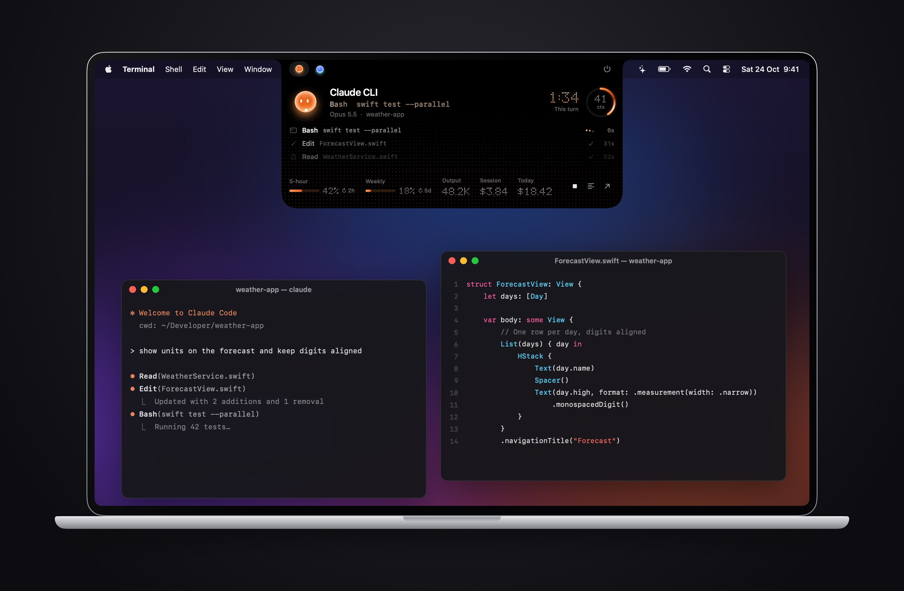
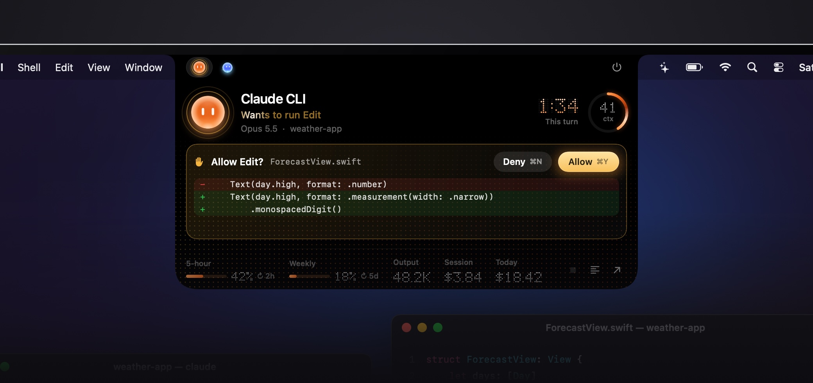
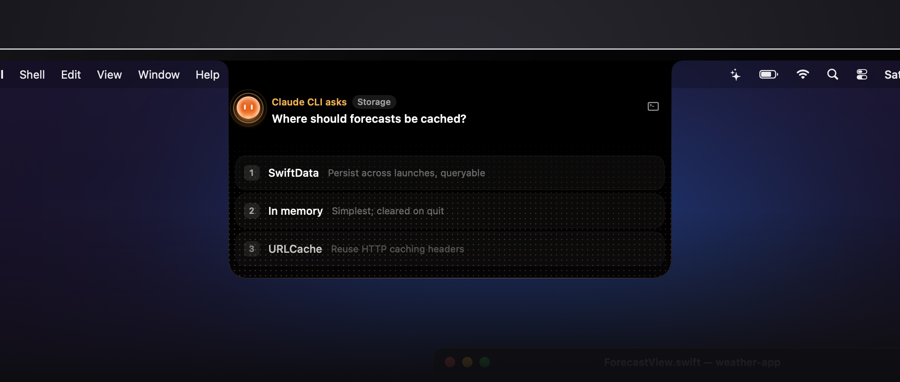
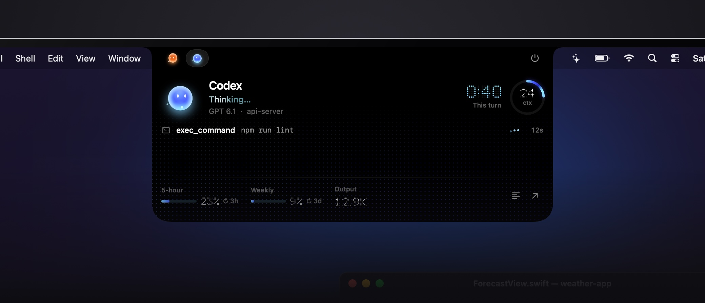
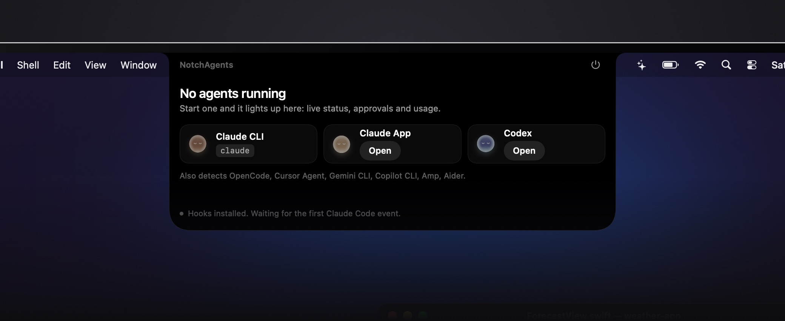
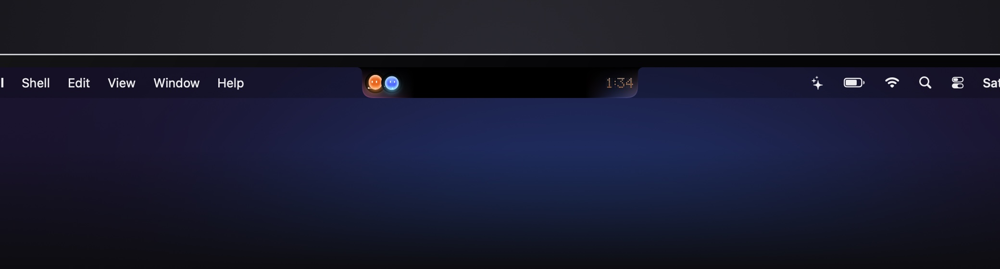
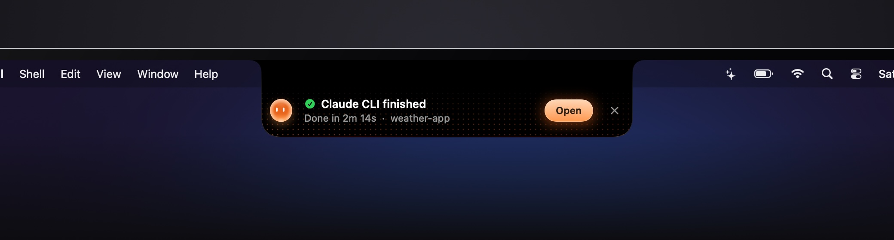

# NotchAgents

Your AI coding agents, living in the MacBook notch.

🌐 **[notchagents.vercel.app](https://notchagents.vercel.app)** · ▶ **[Watch the launch video](docs/video/launch.mp4)** · Made by [@sakshamships](https://x.com/sakshamships)



NotchAgents turns the notch into a Dynamic Island for Claude Code, Codex and other coding agents. See at a glance which agents are running and what they're doing, approve tool calls without switching windows, answer questions, and keep an eye on usage, all from the top of your screen.

- **Live status:** thinking, running a tool (with the command or file), waiting for you, done.
- **Approvals from the notch:** Allow or Deny a permission request with a diff preview, or press ⌘Y / ⌘N.
- **Questions:** answer Claude's multiple-choice questions in the notch (keys 1–4).
- **Usage:** context window, 5-hour and weekly plan limits, session and daily cost.
- **Alerts:** a short banner when an agent finishes or needs you, with subtle sounds you can turn off.
- **Local only:** no accounts, no telemetry, nothing leaves your Mac.

| Approve a tool call | Answer a question |
|---|---|
|  |  |
| **Codex at work** | **Nothing running yet** |
|  |  |

When you're not hovering, the notch stays small: one orb per running agent and the current turn's timer. A banner drops down when an agent finishes or needs you.




## Supported agents

| Agent | How it's detected | What you see |
|---|---|---|
| **Claude Code** (terminal, VS Code, Cursor, JetBrains) | Claude Code hooks + process scan | Full status, tool activity, approvals, questions, context, limits, cost |
| **Claude App** (Claude Code sessions in the desktop app) | Hooks + process scan | Same as above |
| **Codex** (CLI, desktop, or hosted by another app) | Codex's session logs + process scan | Status, tool activity, context, limits |
| **OpenCode** (terminal, or hosted by another app) | Process scan + OpenCode's local database (read-only) | Status, tool activity, model, session cost and tokens |

Only agents that are running appear in the notch and the menu bar.

## Requirements

- An Apple silicon Mac with macOS 15 (Sequoia) or later. It works without a notch too; the island sits at the top centre of the screen. The release DMG is Apple silicon only; Intel Macs can try building from source.
- To build from source: Xcode or the Command Line Tools, with Swift 6 (`xcode-select --install`), and Python 3.

## Install

NotchAgents isn't notarized by Apple yet (that needs a paid Apple developer account), so pick whichever of these you're comfortable with. All three install the same app.

### Quick install (recommended)

```bash
curl -fsSL https://raw.githubusercontent.com/sakshamsaini12/NotchAgents/main/install.sh | bash
```

[`install.sh`](install.sh) is short; read it first if you like. It downloads the DMG from this repo's releases, **refuses to install it unless its SHA-256 matches the checksum written in the script**, checks the app's code signature, copies it to `/Applications` and opens it. It needs no password and changes no system settings. Files downloaded with `curl` aren't quarantined, so macOS doesn't show the "not opened" warning.

Then click the orb in the menu bar → **Install Claude Code hooks**, and start a new Claude Code session.

### Download (DMG)

1. Download `NotchAgents-<version>.dmg` from [Releases](https://github.com/sakshamsaini12/notchagents/releases). You can compare its SHA-256 (`shasum -a 256 NotchAgents-*.dmg`) with the one in the release notes.
2. Drag NotchAgents into Applications.
3. macOS blocks the first launch of apps that aren't notarized. Open it once, dismiss the warning, then go to **System Settings → Privacy & Security** and click **Open Anyway**. (Or, in Terminal: `xattr -dr com.apple.quarantine /Applications/NotchAgents.app`.) You only need to do this once.
4. Click the orb in the menu bar → **Install Claude Code hooks**, and start a new Claude Code session.

### Build from source

```bash
git clone https://github.com/sakshamsaini12/notchagents.git
cd notchagents
./build.sh
```

`build.sh` does the following:

1. Builds the app with SwiftPM and installs it to `/Applications/NotchAgents.app` (or `~/Applications` if that isn't writable), then launches it.
2. Copies two small scripts into `~/.notchagents/`: `notch-hook.sh` (forwards Claude Code hook events) and `notch-status.sh` (forwards the status line, which carries usage data).
3. Registers those scripts in the `settings.json` of `~/.claude`, `$CLAUDE_CONFIG_DIR`, and any other `~/.claude*` config folder that has one:
   - Settings are only rewritten when something changes.
   - The old file is backed up next to it first, as `settings.json.notchagents-backup-<time>`.
   - Your existing hooks and settings are kept.

Start a new Claude Code session after installing so it picks up the hooks.

Because you build the app yourself, macOS doesn't quarantine it and Gatekeeper won't block it.

To package a release, `./make_dmg.sh` builds `dist/NotchAgents-<version>.dmg` (debug symbols stripped, ad-hoc signed). The DMG window layout is written by [dmgbuild](https://github.com/dmgbuild/dmgbuild), installed on first run into `build/dmgbuild-venv` from the hash-pinned `tools/dmg-requirements.txt`, rather than by scripting Finder, so the image records nothing about the machine that built it.

## Using it

- **Hover the notch** to open the island. Hover an agent's icon at the top to switch between agents.
- **Approvals:** when Claude asks permission, the island shows the tool and a preview. Click Allow or Deny, or press ⌘Y / ⌘N while the island is open. If you don't answer within about 100 seconds, the prompt falls back to the terminal as usual.
- **Questions:** pick an option with a click or the number keys. Free-text questions are left to the terminal.
- **Stop:** the stop button interrupts a running Claude turn (like pressing Esc). Click once to arm it, again to confirm.
- **Menu bar:** a summary of every agent, usage bars, hook status, and a **Sound effects** switch.

### What the numbers mean

- **ctx (context):** how full the agent's context window is. The context window is everything the model can see at once: the conversation so far, files it has read, tool output. `41 ctx` means 41% is used. Near 100%, Claude Code compacts (summarises) the conversation to make room, and the agent may lose detail from earlier in the session, so a high number is a good moment to start a fresh session for a new task.
- **5-hour / Weekly:** how much of your plan's rolling usage limits you've used, with the time until each resets (↻ 2h, ↻ 6d). These come from Claude Code's status line and Codex's logs. Limits are tracked per session, so the desktop app and the CLI never show each other's numbers, even when they're signed in to different accounts. The desktop app doesn't run a status line, so its own meters stay hidden.
- **Session / Today:** what the current session, and all of today's sessions from the same client (the CLI or the desktop app, counted separately), would cost at API list prices. On a Pro or Max subscription you aren't billed per token, so treat these as a measure of usage, not a bill. They run slightly low because a few of Claude Code's background calls aren't written to transcripts.
- **Output:** output tokens generated in the current session.

### If you already have a Claude Code status line

Usage limits and exact cost arrive through Claude Code's status line. If you already have one, the installer leaves it alone, so the 5-hour and weekly meters won't appear. To get both, forward the status-line input to NotchAgents from your own script:

```bash
#!/bin/bash
input=$(cat)
printf '%s' "$input" | ~/.notchagents/notch-status.sh
printf '%s' "$input" | /path/to/your-statusline.sh
```

## Privacy and security

NotchAgents is local only. There's no account, no analytics, no crash reporting and no update check: **the app never connects to the internet**. You can check this in the source; the only network code is the local server in [`HookServer.swift`](Sources/NotchAgents/HookServer.swift).

- Everything runs on your Mac. NotchAgents listens only on `127.0.0.1:47823`, and requests must carry a random token stored in `~/.notchagents/token` (readable only by you). The hook scripts read the token from a file rather than passing it on the command line, so other users on the Mac can't see it in `ps`.
- It reads Claude Code transcripts (`~/.claude*/projects`), Codex session logs (`~/.codex/sessions`, `~/.codex/archived_sessions`) and OpenCode's database (`~/.local/share/opencode/opencode.db`, opened read-only) to show activity and usage. It doesn't send them anywhere.
- It doesn't run or modify your agents. The only action it takes is answering a permission or question when you click, and stopping a turn when you confirm Stop.
- The hook scripts exit immediately if the app isn't running, so Claude Code is never slowed down or blocked. They send Claude Code's hook data (the event, the tool and its input, the session's transcript path) to the app on `127.0.0.1` and nowhere else.
- It asks for no macOS permissions: no Accessibility, Screen Recording, Full Disk Access, contacts or location.
- What it writes: `~/.notchagents/` (the hook scripts and the token), the hooks entry in your Claude `settings.json` files (backed up first, and only when you install the hooks), and its preferences (`local.notchagents`: the sound switch and which Claude config folders it has seen).
- The app is open source and built in the open: the release DMG is ad-hoc signed (no developer identity), with debug symbols stripped. If you'd rather not trust a download at all, build it yourself with `./build.sh`.

## Uninstall

```bash
# remove the hooks and status line from every Claude config (from a clone: ./build.sh --uninstall-hooks)
curl -fsSL https://raw.githubusercontent.com/sakshamsaini12/NotchAgents/main/hooks/install_hooks.py | python3 - --uninstall
rm -rf /Applications/NotchAgents.app ~/.notchagents
defaults delete local.notchagents     # optional: forget preferences
```

Backups of your settings (`settings.json.notchagents-backup-*`) stay next to each `settings.json`. Delete them once you're happy.

## Troubleshooting

**The notch shows "Hooks installed. Waiting for the first Claude Code event."**
Hooks only load when a session starts. Start a new Claude Code session.

**An agent isn't detected, or shows the wrong state.**
These commands show what NotchAgents sees:

```bash
APP=/Applications/NotchAgents.app/Contents/MacOS/NotchAgents
$APP --scan      # agent processes found right now
$APP --usage     # Claude config folders, hook status, today's spend
curl -s -H @"$HOME/.notchagents/token.header" "127.0.0.1:47823/?type=state"   # what the app believes
```

Please include their output when you open an issue.

**Codex started by another app (ChatGPT, an editor, a design tool) appears late or disappears.**
These hosts keep Codex running in the background between tasks. NotchAgents shows it while it's working and for a few minutes afterwards.

**Port 47823 is in use.**
The island shows a red server error. Quit whatever is using the port (`lsof -i :47823`) and relaunch NotchAgents.

## Development

```bash
swift build -c release && .build/release/NotchAgents
```

Useful flags:

| Flag | What it does |
|---|---|
| `--render-preview <dir>` | Renders every island state with sample data inside a MacBook mockup (JPEGs), to check layout. The README images come from `--render-preview docs/images`. |
| `--render-icon <file>` | Renders the app icon (used by `build.sh`). |
| `--sounds` | Plays every sound effect in turn. |
| `hooks/demo.sh` | Plays a fake Claude session through a running app: activity, an approval, a completion and a question. |

Set `NOTCHAGENTS_PORT=47901` to run a development copy next to the installed one. Hooks still talk to the installed app on 47823.

The code is plain SwiftUI and AppKit with no dependencies:

| File | Role |
|---|---|
| `AgentStore.swift` | State, hook handling, process scanning, Codex logs |
| `NotchView.swift` | The island |
| `HookServer.swift` | Local HTTP server |
| `Usage.swift` | Claude config folders, pricing, cost ledger |
| `OpenCode.swift` | OpenCode status from its database |
| `Mockup.swift` | MacBook mockup for the README images |
| `Sound.swift` | Sound effects, synthesised in code |
| `Glyphs.swift` | Agent orbs and marks |
| `MenuBar.swift` | Menu bar popover |

Contributions are welcome. Please open an issue first for larger changes.

## License

The code is [MIT](LICENSE).

These files are used by the website and aren't covered by the MIT license; they belong to their owners and aren't licensed for reuse:

- `docs/images/wall.jpg`: macOS wallpaper, © Apple Inc.
- `docs/images/macbook.png`: MacBook mockup frame. MacBook is a trademark of Apple Inc.
- `docs/video/launch.mp4` and `docs/video/poster.jpg`: the launch video and its poster, © Saksham Saini.

NotchAgents isn't affiliated with or endorsed by Apple, Anthropic or OpenAI.
